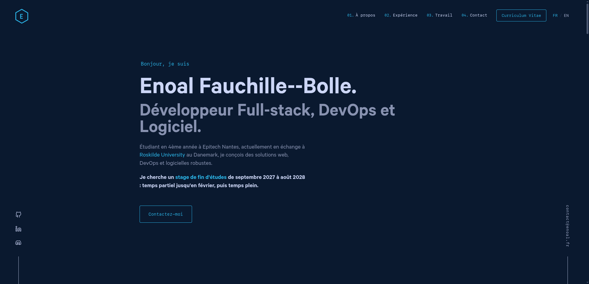

<div align="center">
  
</div>

# 🌐 Portfolio

[](https://github.com/Enoal-Fauchille-Bolle/Portfolio/actions/workflows/docker-publish.yml)
[](https://github.com/Enoal-Fauchille-Bolle/Portfolio/releases/latest)
[](./LICENSE)

> My personal website, live at **[enoal.fr](https://enoal.fr)**: a bilingual
> (French / English) static site built with Gatsby, containerized behind Nginx,
> released to GHCR on every tag and deployed on my K3s homelab.

Based on [Brittany Chiang's v4](https://github.com/bchiang7/v4), see [Credits](#-credits).



---

## 📖 About

The design comes from an open-source template; almost everything around it has
been rebuilt to treat a personal site like a production service:

- **Content as data**: every job and project is a Markdown file under
  [`content/`](./content), so adding one never touches the components.
- **French first, English second**: French is served on `/`, English under
  `/en/`, with `hreflang` tags and a language switcher. No redirection on the
  browser's language: `enoal.fr` means the same page for everyone.
- **Release engineering**: a `vX.Y.Z` tag builds a Docker image, pushes it to
  GHCR and creates a GitHub Release whose notes
  [git-cliff](https://git-cliff.org/) writes from the Conventional Commits.
- **Homelab deployment**: the image runs on a K3s cluster through a Helm chart
  kept in [Astra-ops](https://github.com/Enoal-Fauchille-Bolle/Astra-ops).
- **Guarded commits**: Git hooks scan for secrets, lint, format and reject any
  message that does not follow the convention, because the repository is public.

---

## 🚀 Quick start

Requires Node.js 22 (pinned in [`.nvmrc`](./.nvmrc)) and npm.

```bash
nvm install       # use the Node version from .nvmrc
npm install       # also installs the Git hooks
npm start         # dev server on http://localhost:8000
```

| Command          | Effect                                                |
| ---------------- | ----------------------------------------------------- |
| `npm start`      | development server with hot reload                    |
| `npm run build`  | full static production build into `public/`           |
| `npm run serve`  | preview the production build on http://localhost:9000 |
| `npm run clean`  | remove Gatsby's `.cache` and `public/`                |
| `npm run format` | format every JS, JSON and Markdown file with Prettier |

> After `npm run clean`, ESLint fails on every JSX file until the next build or
> `npm start` regenerates `.cache`, so the pre-commit hook rejects commits in
> the meantime.

---

## ✍️ Editing content

| What                      | Where                              | Shown in                          |
| ------------------------- | ---------------------------------- | --------------------------------- |
| Jobs                      | `content/jobs/<Company>/index.md`  | Experience tabs                   |
| Featured projects         | `content/featured/<Name>/index.md` | Large cards, with a `cover` image |
| Other projects            | `content/projects/<Name>.md`       | Project grid and `/archive` table |
| Interface text            | `locales/{fr,en}/translation.json` | Everywhere                        |
| Email, social links, menu | [`src/config.js`](./src/config.js) | Navigation, sidebar, footer       |

A project with `showInProjects: false` is left out of the home page grid but
stays in the `/archive` table.

### Translations

French is the source. The English version of an entry is a sibling file with
an `.en` suffix (`index.en.md`, `Arcade.en.md`). An entry without one falls
back to French on the English site, on purpose.

That fallback hides two mistakes, so check for them before committing:

```bash
python3 organization/check-i18n.py
```

It reports an `.en.md` whose frontmatter (`date`, `order`, `showInProjects`…)
differs from its French source, which would reorder or drop the entry in
English, and any key present in one `translation.json` but not the other, which
would print the raw key instead of the text.

---

## 📦 Deployment

### Run the image locally

```bash
docker compose up --build   # http://localhost:8000
```

The [`Dockerfile`](./Dockerfile) builds the site with Node, deletes the source
maps, then serves `public/` with Nginx using
[`nginx/nginx.conf`](./nginx/nginx.conf) (gzip, cache headers, `/fr` redirect).

### Analytics

The tracking script of [Umami](https://umami.is/) is injected only when these
build arguments are set:

| Build argument            | Purpose                        |
| ------------------------- | ------------------------------ |
| `GATSBY_UMAMI_WEBSITE_ID` | site ID in Umami               |
| `GATSBY_UMAMI_DOMAINS`    | domains allowed to send events |
| `GATSBY_UMAMI_HOST_URL`   | URL of the Umami instance      |

Gatsby writes `GATSBY_*` variables into the static files **at build time**:
passing them to `docker run` has no effect. In CI they come from the
repository's Actions variables.

### Release

```bash
git tag -a v1.8.0 -m "v1.8.0"
git push origin v1.8.0
```

The [workflow](./.github/workflows/docker-publish.yml) then:

1. builds the image and pushes it to
   `ghcr.io/enoal-fauchille-bolle/portfolio`, tagged `1.8.0` and `latest`;
2. writes the release notes with git-cliff from [`cliff.toml`](./cliff.toml);
3. creates the GitHub Release.

The homelab runs a pinned version: bump `image.tag` in Astra-ops'
`k3s/portfolio/values.yaml` to roll it out.

---

## 🪝 Git hooks

[Husky](https://typicode.github.io/husky/) installs two hooks on `npm install`.

**`pre-commit`** scans the staged changes for secrets with
[Betterleaks](https://github.com/betterleaks/betterleaks), then runs ESLint and
Prettier on them through lint-staged. Without Betterleaks, the hook prints a
warning and skips the scan, so install it:

```bash
brew install betterleaks        # macOS, Linux
sudo dnf install betterleaks    # Fedora
```

On Windows, download `betterleaks_<version>_windows_x64.zip` from the
[releases](https://github.com/betterleaks/betterleaks/releases) and put
`betterleaks.exe` on the `PATH`. If the scan flags something that is not a
secret, end that line with a `betterleaks:allow` comment:

```js
const example = 'not-a-real-key'; // betterleaks:allow
```

**`commit-msg`** enforces the format git-cliff parses:
`type(scope): subject`, on a single line, lowercase, without a trailing period.
Types: `feat`, `fix`, `perf`, `refactor`, `docs`, `style`, `test`, `build`,
`ci`, `chore`.

---

## 🏗️ Stack

| Layer   | Tools                                               |
| ------- | --------------------------------------------------- |
| Site    | Gatsby 5, React, styled-components, i18next         |
| Content | Markdown, `gatsby-transformer-remark`               |
| SEO     | sitemap, `robots.txt`, `hreflang`, Open Graph image |
| Serving | Nginx (Alpine) in a multi-stage Docker image        |
| CI/CD   | GitHub Actions, GHCR, git-cliff                     |
| Hosting | K3s homelab, Helm chart in Astra-ops                |
| Quality | ESLint, Prettier, Husky, lint-staged, Betterleaks   |

---

## 📁 Project structure

```
.
├── content/                 # Markdown content
│   ├── featured/            #   featured projects, with a cover image
│   ├── jobs/                #   work experience
│   └── projects/            #   other projects
├── locales/{fr,en}/         # interface translations
├── nginx/nginx.conf         # Nginx config of the served image
├── organization/
│   └── check-i18n.py        # translation consistency checks
├── src/
│   ├── components/          # layout, navigation and page sections
│   ├── i18n/                # language list and routing
│   ├── pages/               # home, /archive, 404
│   ├── styles/              # global styles, colors, fonts
│   └── config.js            # email, social links, menu
├── static/og.png            # Open Graph preview image
├── gatsby-*.js              # Gatsby configuration and build hooks
├── cliff.toml               # release notes template
├── Dockerfile
└── docker-compose.yml
```

---

## 🙏 Credits

This site started as a fork of [v4](https://github.com/bchiang7/v4) by
[Brittany Chiang](https://brittanychiang.com), who designed and built the
original layout. It is used here under the MIT license, with her copyright
notice kept in [`LICENSE`](./LICENSE). Thank you, Brittany.

---

## 📝 License

[MIT](./LICENSE).
